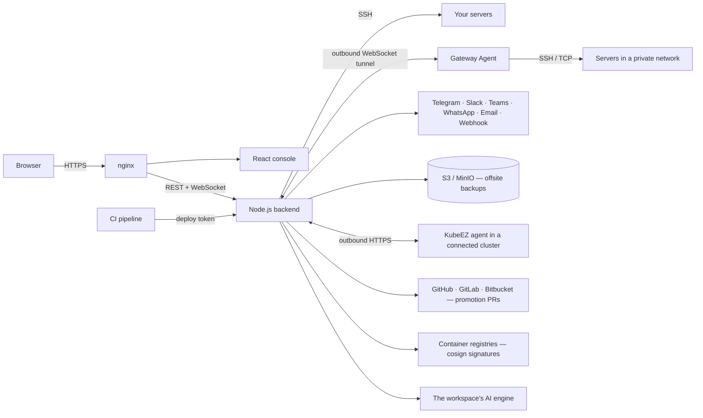

# KubeEZ — Kubernetes made easy

**Install, upgrade, back up and heal production Kubernetes clusters — and ship apps to them — from one console.**
Every step streams a live log, and when something fails you get the reason and the fix, not a stack trace.
Bring the clusters you already run (EKS, AKS, GKE, k3s, OpenShift…) too.

> Repository: `Universal-K8s-Installer` · Product: **KubeEZ** · Hosted edition: [k8scluster.space](https://k8scluster.space)

---

## What it does

| | |
|---|---|
| **Deploy** | Guided wizard with pre-flight checks (OS, CPU, memory, ports, connectivity). Kubernetes **1.27 → 1.37**, Flannel or Calico. **High availability** with 3 control-planes behind a floating virtual IP (**kube-vip**). Stopped installs **resume** — finished steps are skipped. |
| **Upgrade** | One minor version at a time, with an **upgrade safety check** (removed APIs, version skew, blocking disruption budgets), an automatic etcd snapshot first, clear failure reasons and retry. |
| **Connect existing clusters** | EKS, AKS, GKE, OKE, DigitalOcean, Linode, k3s, RKE2, OpenShift, kubeadm… through an in-cluster **KubeEZ agent** (outbound only), a connect command or a kubeconfig used once. **Read-only** or **Full manage**; with a cloud account, node pools and Kubernetes upgrades of EKS / AKS / GKE / OKE / DOKS / LKE. |
| **Add-ons** | 30 add-ons: Nginx Ingress, Prometheus + Grafana, Kubernetes Dashboard, cert-manager, Longhorn, Argo CD, S3 storage (SeaweedFS), Velero, **KubeEZ Explorer**, **Metrics Server**, **MetalLB**, **Loki logs**, **Sealed Secrets**, **External Secrets**, **Argo Rollouts**, **KEDA**, **Kyverno policies**, **NFS storage**, **Volume snapshots**, **Elasticsearch + Kibana**, **Fluentd**, **Fluent Bit**, **Harbor registry**, **Flux CD**, **Jenkins**, **HashiCorp Vault**, **OPA Gatekeeper**, **Falco**, **Trivy Operator**, **KubeEZ AI** — install, repair, reinstall, uninstall and logs from the UI. **Every add-on is customizable** like a Helm chart — before install (also in the new-cluster wizard) and any time after: a **settings form**, **changes with a preview** and automatic rollback, history, versions (one release line at a time where the project requires it) and, on Pro, **advanced Helm values**. Add-ons installed by older KubeEZ versions are taken over by Helm in place. **New add-on versions are found automatically** (chart repositories checked every 12 hours) and announced once — badge, top-bar menu and alert — and applied only when you choose the version. |
| **Backups** | Verified **etcd snapshots** with a preview of what a restore changes, automatic rollback and undo (HA clusters too) · **volume data** backups (Velero) · **encrypted offsite copies** (S3 / MinIO / any S3) · **disaster recovery** of a lost control-plane · daily config backups. |
| **Auto-healing** | Nodes, control plane (API, scheduler, controller-manager, etcd), certificates, disk, pods, workloads, volume claims and jobs are checked every 1–2 minutes. Known problems are fixed automatically (with verification and retries), the rest are diagnosed with evidence. **Warns before things break:** disk-fill forecast per node ("full in ~9 h", cleaned up before it is), CPU / memory above 90 % for 15 min with the pods responsible, and live node usage bars. Root-cause grouping, a timeline per incident, policies (fix / alert only / off), maintenance mode, MTTR and fix-rate statistics. |
| **Alerts** | Telegram, Slack, Microsoft Teams, WhatsApp (Twilio), email and webhooks — incidents, failed backups, restores, upgrades, finished jobs, Gateway Agent offline / back online. Quiet hours with a morning summary, cooldown, per-event rules, **routing** per channel (clusters, minimum severity) and **escalation** when nobody acknowledges. **Act from the alert:** Acknowledge / Mute / Fix now buttons in Telegram, signed confirmation links everywhere else. |
| **Compliance** | A live scan of each cluster (every node over SSH + KubeEZ's own records + the **CIS benchmark** with kube-bench) mapped to **CERT-In Directions 2022**, the **DPDP Act 2023 & Rules 2025**, **ISO/IEC 27001:2022** and **CIS**: 29 controls with evidence and fixes, scores per framework and history, attestations (CERT-In point of contact, data in India, …), one-click fix to **NIC / NPL time servers**, a **sealed PDF report** and JSON evidence, monthly reports by email with an alert when a control regresses, and a pre-filled **CERT-In incident report** with the 6-hour deadline. A **tamper-evident audit trail** (SHA-256 chain, 400 days) records every change, sign-in and restore. |
| **Explorer** | A full Kubernetes UI inside KubeEZ (based on [Radar](https://github.com/skyhook-io/radar), Apache-2.0): every resource, logs, timeline, Helm, GitOps and a 31-check audit — with your KubeEZ login and role, no open ports. |
| **KubeEZ AI** | **Ask AI** about your clusters in English, Hindi or Hinglish — answered from live data (pods, logs, events, exact counts) by the AI your workspace connects (OpenRouter sign-in, OpenAI / Claude / Gemini keys, or Ollama / vLLM / LM Studio in your own cluster). Incident explanations with fixes you preview (dry-run) before applying, **Create YAML**, **Fleet**, **Advisor**, **What changed**, ChatOps in **Slack and Telegram**, an MCP server, masking of secrets, and a quality test to pick the best model. |
| **Helm apps** | Your own releases per cluster: install / upgrade from the workspace's chart repositories with a **server-side dry-run diff**, roll back to any revision, values with secrets masked. **Deploy risk**: a 0–100 score from the diff, history and open problems, explained by the AI. **Helm drift**: what was changed by hand (`kubectl diff` against the deployed manifest), restored in one click, hourly alerts. |
| **Delivery** | **Environments** (protected = two people for every deploy), **change freezes**, environment **compare & promote**, **auto-rollback** of bad deploys, registry pull secrets, **deploy tokens + CI webhook** (with DORA lead time from the commit), **preview environments** per pull request that remove themselves, and **deploy from chat** (Slack / Telegram, confirmed with a code). |
| **Deploy guards** | Per environment: a **CVE gate** (Trivy reports) and an **image signature gate** (cosign, verified in the registry against the workspace's keys) — warn or block, admin override with a reason, on every deploy path. |
| **GitOps** | Argo CD and Flux apps on one list: sync / health / drift, **Sync now**, alerts, **Explain with AI**; new **Argo CD or Flux apps** locked to one namespace; **promotions by pull request** on **GitHub, GitLab and Bitbucket**. |
| **Security & insight** | **Trivy** vulnerabilities and misconfigurations per workload with new-CVE alerts; **cert-manager** certificates, issuers and stuck ACME challenges with **Renew now** and expiry alerts; **DORA** metrics (deploy frequency, change failure rate, recovery time, lead time); app metrics from Prometheus; **cost per app**; External Secrets status. |
| **Day-2 operations** | **Hibernate / Wake** namespaces (also on a schedule), ephemeral **debug containers**, **canary rollouts** (Argo Rollouts promote / abort), **KEDA** autoscaling wizard. |
| **Reach anything** | **Gateway Agent**: servers in private networks are managed through an outbound tunnel — no inbound firewall ports. |
| **Teams** | Isolated workspaces with Admin / Operator / Viewer and **custom roles**, per-cluster, per-label and per-namespace access, **two-person approvals**, temporary access, access review CSV. Sign in with username or email, Google / GitHub, or **SSO (any OpenID Connect provider)**. |
| **Features & plans** | Newer features can be switched on one by one (server-wide and per workspace). Free workspaces see every feature and are asked to upgrade for Pro ones; **Pro and Enterprise include every feature**. |

**Supported node OS:** Ubuntu 22.04 / 24.04, Debian 12, Rocky Linux 9, AlmaLinux 9, Fedora, Amazon Linux 2023 (all tested end-to-end), RHEL 8 / 9. Kubernetes 1.35+ needs cgroups v2 — CentOS 7 / RHEL 7 are supported up to Kubernetes 1.34.

---

## Quick start

Requirements: **Docker** with Docker Compose. The nodes you want to turn into a cluster need SSH (self-hosted) or a Gateway Agent (SaaS).

```bash
git clone https://github.com/ckmine11/Universal-K8s-Installer.git
cd Universal-K8s-Installer
cp .env.example .env          # set APP_SECRET (openssl rand -hex 32) and, for email, the SMTP_* values
docker compose up -d --build  # development: frontend :5173, backend :3000
```

Open **http://localhost:5173**. With `KUBEEZ_MODE=selfhosted` in `.env`, the first screen of a fresh server creates the **first administrator** — there is no default password. (The compose files default to SaaS mode, where the platform owner is created with `make-superadmin.js`, below.)

### Production

```bash
docker compose -f docker-compose.prod.yml up -d --build   # nginx proxy on :80 (and :8090) → frontend + backend
```

Put it behind HTTPS (e.g. Cloudflare, see [CLOUDFLARE_SETUP.md](CLOUDFLARE_SETUP.md)). In SaaS mode the platform owner account is created with:

```bash
docker exec -it kubeez-backend node scripts/make-superadmin.js <username> <password> <email>
docker compose -f docker-compose.prod.yml restart backend
```

Update a running server:

```bash
git pull && docker compose -f docker-compose.prod.yml up -d --build backend frontend
```

---

## Configuration (`.env`)

| Variable | Purpose |
|---|---|
| `APP_SECRET` | **Strongly recommended.** Encrypts stored credentials and signs sessions — 64 random hex characters. Keep it; changing it makes stored secrets unreadable. Without it a key is generated in `data/master.key`. |
| `KUBEEZ_MODE` | `saas` (hosted, nodes through Gateway Agents) or `selfhosted` (direct SSH, license key). The compose files default to `saas`. |
| `KUBEEZ_PUBLIC_URL` | Public address (e.g. `https://k8scluster.space`) — used in alert and email links. |
| `ALLOWED_ORIGINS` | Extra browser origins allowed to call the API (the site's own address always is). |
| `SMTP_HOST`, `SMTP_PORT`, `SMTP_SECURE`, `SMTP_USER`, `SMTP_PASS`, `EMAIL_FROM`, `EMAIL_REPLY_TO` | Email: password reset codes, welcome / invite emails, email alerts. Port 465 = TLS, 587 = STARTTLS. Gmail needs an App Password; for inbox delivery use your own domain via Brevo / Resend / SES with SPF, DKIM and DMARC. |
| `ALERT_EMAILS_PER_DAY_FREE`, `ALERT_EMAILS_PER_DAY_PAID` | Daily alert-email allowance per workspace (default 20 / 200). |
| `STRIPE_*` | Billing (hosted edition). |
| `GOOGLE_CLIENT_ID/SECRET`, `GITHUB_CLIENT_ID/SECRET` | "Continue with Google / GitHub" (callback `<KUBEEZ_PUBLIC_URL>/api/auth/oauth/<provider>/callback`). |
| `OIDC_ISSUER`, `OIDC_CLIENT_ID`, `OIDC_CLIENT_SECRET`, `OIDC_ROLE_MAP`, `OIDC_DEFAULT_ROLE`, … | Single sign-on with any OpenID Connect provider; groups map to roles. |
| `KUBEEZ_FEATURES`, `KUBEEZ_FEATURES_DEFAULT` | Which features the server offers, e.g. `gitops=on,previews=off`; `KUBEEZ_FEATURES_DEFAULT=off` to enable them one by one. |
| `KUBEEZ_OPEN_SIGNUP` | `true` lets anyone create a workspace (self-hosted: off by default). |

See [.env.example](.env.example) for the full list.

---

## How it works



The backend pushes idempotent Bash scripts (`backend/src/automation/`) to the nodes over SSH or through a Gateway Agent and streams their output to the browser. Machine-readable result lines (`KUBEEZ_FAIL|code|reason|fix`, `KUBEEZ_PROGRESS|…`) turn failures into a reason and a fix on screen. Auto-healing keeps one SSH session per cluster and polls nodes, pods and cluster health; playbooks fix or diagnose, then verify.

Connected clusters are reached through their API (directly, through a Gateway Agent, or through the in-cluster KubeEZ agent); their kubectl / helm commands run on the KubeEZ server in a per-cluster sandbox. Helm apps, GitOps, Trivy, cert-manager and drift are read with `kubectl` / `helm` on the control-plane (or in that sandbox) — KubeEZ asks the tools to do their own job and never reads Secrets. Every change goes through the same gates: role and namespace limits, two-person approval, change freezes, and the environment's CVE and signature policies; every one is in the tamper-evident audit trail.

**Data:** KubeEZ keeps its state in JSON files under `backend/data` (written atomically; credentials encrypted with `APP_SECRET`) — one server per installation.

---

## Project layout

```
frontend/                 React + Vite + Tailwind console ("Aurora Glass" theme)
  src/pages/              Clusters, Incidents, Alerts, Delivery, Features, AI, Connected clusters, Docs …
  src/components/         shell (sidebar, Ctrl+K), apps, gitops, security, delivery, ai …
backend/
  src/routes/             REST API (+ /api/hooks for CI, /api/chatops for Slack)
  src/services/           automation engine, auto-healing (incidentDetector, remediationEngine),
                          alerts (notifier), backups, Explorer proxy, Gateway Agent service,
                          cluster import (clusterAccess, clusterImport), ai/ (engines, ChatOps, safety),
                          helmApps, gitops, gitPromote, previews, chatDeploy, signGate, deployRisk,
                          helmDrift, certManager, security (Trivy), dora, costs, features …
  src/config/             permissions (roles), add-on definitions, compliance controls
  src/automation/         Bash scripts: install, join, upgrade, etcd backup / restore, recovery, add-ons
  scripts/                make-superadmin.js, reset-password.js, license tools
  tests/                  node:test suites (npm test)
tests/e2e/                end-to-end runs on real distros in Docker (install, upgrade, HA, restore, recovery, Velero, Explorer, agent)
nginx/                    production reverse proxy
```

---

## Development & tests

```bash
cd backend && npm install && npm test        # ~750 tests: API gates per role, auto-healing, backups, AI, delivery … (node:test)
cd frontend && npm install && npm run dev    # console with hot reload on :5173 (API proxied to :3000)
bash tests/e2e/e2e.sh install ubuntu2204      # real kubeadm install in a systemd container (needs Docker, cgroups v2)
bash tests/e2e/e2e.sh ha-vip ubuntu2204       # 3 control-planes + kube-vip failover
```

Node.js **20 or newer** (the Docker images use Node 22 LTS).

---

## Security

- Node passwords, SSH keys, bot tokens and webhook URLs are **encrypted at rest** (`APP_SECRET`) and never sent back to the browser.
- Sessions are httpOnly cookies; a password change or reset ends all other sessions; per-account login lockout; CSRF-safe same-site checks.
- Workspaces are isolated; roles are enforced by the API, not only the UI.
- In SaaS mode the server never opens direct SSH connections or webhook requests to private / internal addresses (SSRF) — private servers are reached only through their own Gateway Agent.
- The KubeEZ Explorer is reachable only through KubeEZ's authenticated proxy — no ports are opened in the cluster.
- Deploy tokens are shown once and stored as a SHA-256 hash; each deploys one release and changes only the values it lists. Chat deploys need a confirmation code from the same person.
- Text sent to an AI engine is masked (secrets, and optionally emails / IPs) and wrapped as untrusted data; AI fixes are dry-run first and follow the member's permissions and approvals.

Found a vulnerability? Please report it privately to the maintainers instead of opening a public issue.

---

## More documentation

The full user guide is built into the console (**Help → Docs**). In this repository: [DEPLOY.md](DEPLOY.md) · [TROUBLESHOOTING.md](TROUBLESHOOTING.md) · [CLOUDFLARE_SETUP.md](CLOUDFLARE_SETUP.md) · [THIRD_PARTY_NOTICES.md](THIRD_PARTY_NOTICES.md) · [CHANGELOG.md](CHANGELOG.md) · [CONTRIBUTING.md](CONTRIBUTING.md)
